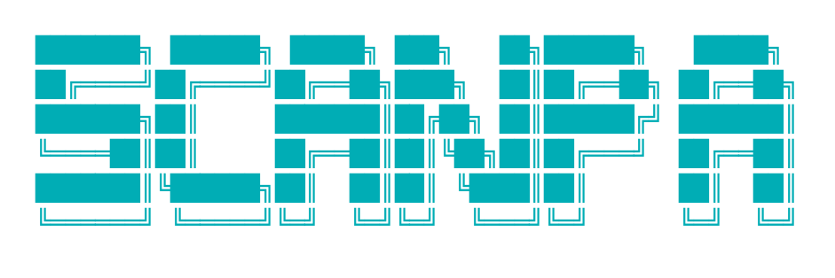

<div align="center">
  
</div>

<h2 align="center">📡 w i f i &nbsp;·&nbsp; n e t w o r k &nbsp;·&nbsp; s c a n 📡</h2>

<div align="center">


</div>

<p align="center">
  <b>ScanPa</b> es una herramienta de línea de comandos que utiliza una placa MicroPython (ESP32 / ESP8266) conectada por USB para <b>escanear puntos de acceso WiFi</b> cercanos de forma continua y mostrar un informe claro y ordenado directamente en tu terminal, con identificación de fabricante, estimación de distancia y registro automático en TXT y CSV.
</p>

<br>

## 📑 Índice

- [Características](#-características)
- [Vídeo de ScanPa en acción](#-vídeo-de-scanpa-en-acción)
- [Requisitos](#-requisitos)
- [Instalación](#-instalación)
- [Uso](#-uso)
- [Ejemplo de salida](#-ejemplo-de-salida)
- [Identificación de fabricante (OUI)](#-identificación-de-fabricante-oui)
- [Registro de resultados (TXT y CSV)](#-registro-de-resultados-txt-y-csv)
- [Estimación de distancia](#-estimación-de-distancia)
- [Cómo funciona](#-cómo-funciona)
- [Estructura del proyecto](#-estructura-del-proyecto)
- [Solución de problemas](#-solución-de-problemas)
- [Roadmap](#-roadmap)
- [Licencia](#-licencia)

---

## ✨ Características

- 🔍 **Escaneo de redes WiFi** cercanas usando el chip WiFi de la propia placa MicroPython.
- 🔄 **Escaneo continuo automático**: el programa repite el escaneo cada pocos segundos (configurable) y refresca la tabla en pantalla sin intervención manual, hasta que se detiene con `Ctrl+C`.
- 🏭 **Identificación del fabricante** de cada punto de acceso a partir de su MAC (OUI), **100% offline**, con tabla local descargable y overrides manuales.
- 📶 **Cálculo de calidad de señal** (RSSI convertido a porcentaje y etiqueta descriptiva).
- 📏 **Estimación de distancia aproximada** (en metros) a cada punto de acceso a partir del RSSI.
- 🔐 **Detección del tipo de seguridad** de cada red (Abierta, WEP, WPA, WPA2, WPA3...).
- 🆔 Muestra **SSID, BSSID (MAC), fabricante, canal, banda (2.4/5 GHz)** y si la red está oculta.
- 🏆 Identifica automáticamente la **red con mejor señal** en cada ciclo de escaneo.
- 📝 **Registro automático en TXT y CSV**: cada sesión genera un fichero TXT y un fichero CSV con fecha y hora, a los que se van **añadiendo** los resultados de cada nuevo escaneo (histórico completo de la sesión, no solo del último escaneo).
- 🧹 **Refresco limpio de pantalla** en cada actualización, para una vista tipo "dashboard" en la terminal.
- ✅ **Comprobación automática de la placa**: si no está conectada, te avisa y espera a que la conectes antes de escanear.
- 🎨 Interfaz de terminal con **título ASCII** y mensajes claros de estado.

---

## 🎬 Animación: cómo funciona ScanPa

<div align="center">
  
</div>

<p align="center"><sub>El punto recorre el ciclo que se repite automáticamente cada <code>INTERVALO_SEGUNDOS</code>: escanear → procesar → mostrar → guardar → esperar. La detección inicial de la placa ocurre una sola vez, al arrancar.</sub></p>

---

## 🔌 Hardware y firmware utilizados

Este proyecto ha sido desarrollado y probado con la siguiente placa y configuración específica. Si usas un chip distinto, los drivers/firmware podrían variar:

```
Connected to ESP32 on COM3:
Chip type: ESP32-D0WD-V3 (revision v3.1)
Features: Wi-Fi, BT, Dual Core + LP Core, 240MHz, Vref calibration in eFuse, Coding Scheme None
Crystal frequency: 40MHz
MAC:  08:b6:1f:b8:be:08
```

> ⚠️ **Nota:** si usas otra placa (ESP8266, otra revisión de ESP32, etc.), asegúrate de instalar el firmware de MicroPython correspondiente a tu chip específico desde [micropython.org/download](https://micropython.org/download/), ya que el firmware no es intercambiable entre distintos chips.

---

## 🧰 Requisitos

- **Python 3.x** instalado en tu ordenador.
- Librería [`mpremote`](https://pypi.org/project/mpremote/) instalada:

  ```bash
  pip install mpremote
  ```

- Una placa compatible con **MicroPython** (ESP32 o ESP8266) con firmware de MicroPython ya cargado.
- Cable USB de datos (no solo de carga) para conectar la placa al ordenador.
- El fichero `oui_local.json` con la tabla de fabricantes (ver [Identificación de fabricante](#-identificación-de-fabricante-oui)). Es opcional, pero sin él solo se reconocerán los fabricantes que añadas a mano.

---

## 📦 Instalación

1. Clona este repositorio:

   ```bash
   git clone https://github.com/tu-usuario/scanpa.git
   cd scanpa
   ```

2. Instala las dependencias:

   ```bash
   pip install mpremote
   ```

3. (Recomendado) Genera la tabla local de fabricantes, una única vez y con conexión a internet:

   ```bash
   python descargar_oui.py
   ```

   Esto crea `oui_local.json` en el directorio del proyecto. A partir de aquí, `scanpa.py` funciona **completamente offline** para identificar fabricantes.

4. Conecta tu placa MicroPython por USB.

5. (Opcional) Comprueba el puerto en el que se ha conectado tu placa y ajústalo en el script si es necesario (ver [Configuración](#-uso)).

---

## 🚀 Uso

Ejecuta el script desde la terminal:

```
┌──○ ○ ○─── terminal ───────────────────────────────────────────────┐
│ $ python scanpa.py                                                 │
└─────────────────────────────────────────────────────────────────┘
```

El programa mostrará el título de bienvenida y esperará a que pulses **Enter** para comenzar. A continuación comprobará si la placa está conectada:

```
┌──○ ○ ○─── scanpa.py ──────────────────────────────────────────────┐
│                                                                     │
│  ❌ ERROR: No se ha detectado ninguna placa en el puerto COM3.     │
│     Conecta la placa por USB y pulsa Enter para reintentar         │
│     (o Ctrl+C para salir)...                                       │
│                                                                     │
│  ✅ Placa detectada correctamente en COM3. Iniciando escaneo...    │
│                                                                     │
└─────────────────────────────────────────────────────────────────┘
```

- ❌ Si **no detecta la placa**, mostrará un error y esperará a que la conectes, reintentando cada vez que pulses Enter.
- ✅ Si la placa **está conectada**, comenzará un **bucle de escaneo continuo**: escanea, muestra la tabla actualizada, registra los resultados en TXT y CSV, espera unos segundos y vuelve a escanear. El bucle se mantiene indefinidamente hasta que pulsas `Ctrl+C`.

### ⚙️ Configurar el puerto y el intervalo

Por defecto, el script usa el puerto `COM3` (Windows) y refresca el escaneo cada `5` segundos. Ambos valores se pueden ajustar al principio del script:

```python
PUERTO = "COM3"          # Cambia por el puerto de tu placa
INTERVALO_SEGUNDOS = 5   # Cada cuántos segundos se repite el escaneo
```

> En Linux/Mac el puerto suele ser algo como `/dev/ttyUSB0` o `/dev/cu.usbserial-XXXX`.

---

## 🖥️ Ejemplo de salida

Cada vuelta del bucle limpia la pantalla y repinta el título ASCII, el conteo de redes, la tabla ordenada por señal y el estado del refresco automático:

```
╔═════════════════════════════════════════════════════════════════════════════════════════════════════════════════════════════════════╗
║                                                                                                                                     ║
║                                                                                                                                     ║
║                                         ███████╗ ██████╗ █████╗ ███╗   ██╗ ██████╗   █████╗                                         ║
║                                         ██╔════╝██╔════╝██╔══██╗████╗  ██║ ██╔══██╗ ██╔══██╗                                        ║
║                                         ███████╗██║     ███████║██╔██╗ ██║ ██████╔╝ ███████║                                        ║
║                                         ╚════██║██║     ██╔══██╗██║╚██╗██║ ██╔═══╝  ██╔══██║                                        ║
║                                         ███████║╚██████╗██║  ██║██║ ╚████║ ██║      ██║  ██║                                        ║
║                                         ╚══════╝ ╚═════╝╚═╝  ╚═╝╚═╝  ╚═══╝ ╚═╝      ╚═╝  ╚═╝                                        ║
║                                                                                                                                     ║
║                                                                                                                                     ║
║                                    📡   e s c a n e a n d o   p u n t o s   d e   a c c e s o   📡                                  ║
║                                                                                                                                     ║
║                                             ────────────────────────────────────────────                                            ║
║                                              w i f i   ·   n e t w o r k   ·   s c a n                                              ║
║                                                                                                                                     ║
╚═════════════════════════════════════════════════════════════════════════════════════════════════════════════════════════════════════╝

---------------------------------------------------------------------------------------------------------------------------------

 Se han detectado 3 redes en total.

---------------------------------------------------------------------------------------------------------------------------------
SSID                 BSSID              Fabricante             Canal   RSSI    Calidad      Dist. (m)   Seguridad          Oculta
---------------------------------------------------------------------------------------------------------------------------------
MiRed_5G             aa:bb:cc:dd:ee:ff  TP-Link                36      -45     Excelente    0.32        WPA2-PSK           No
Vecino_WiFi          11:22:33:44:55:66  Huawei                 6       -62     Muy buena    1.75        WPA/WPA2-PSK       No
CAFE_FREE_WIFI       77:88:99:aa:bb:cc  Desconocido            11      -78     Débil        10.8        Abierta (sin ...)  No
---------------------------------------------------------------------------------------------------------------------------------

Red más potente: MiRed_5G | TP-Link | -45 dBm | Calidad: Excelente (100%) | Distancia aprox.: 0.32 m

---------------------------------------------------------------------------------------------------------------------------------

🔄 Actualizando cada 5 s | Última actualización: 2026-08-19 10:15:32
   (Ctrl+C para detener)

---------------------------------------------------------------------------------------------------------------------------------
```

> La tabla se reordena en cada ciclo de mayor a menor RSSI, y tanto el TXT como el CSV de la sesión reciben una nueva entrada con el mismo timestamp que aparece en "Última actualización".

---

## 🏭 Identificación de fabricante (OUI)

ScanPa identifica el fabricante de cada punto de acceso a partir de los tres primeros bytes de su BSSID (MAC), conocidos como **OUI** (*Organizationally Unique Identifier*), sin necesidad de conexión a internet durante el escaneo.

La resolución sigue este orden de prioridad:

1. **`FABRICANTES_LOCALES`**: diccionario editable a mano al principio de `scanpa.py`, pensado para anotar routers concretos de tu entorno (operadora, vecinos...). Tiene prioridad sobre cualquier otra fuente.

   ```python
   FABRICANTES_LOCALES = {
       "F8:0B:BE": "Movistar (router HGU)",
       "AC:9B:0A": "Vodafone (router)",
   }
   ```

2. **`oui_local.json`**: tabla completa de fabricantes, generada una única vez con `descargar_oui.py` (requiere internet solo en ese momento). Se carga en memoria al arrancar el script y se consulta sin volver a tocar disco por cada red.

3. Si el OUI no aparece en ninguna de las dos fuentes anteriores, se muestra como **"Desconocido"**.

Si `oui_local.json` no existe, ScanPa avisa por consola y sigue funcionando igualmente, solo que únicamente reconocerá los fabricantes que hayas añadido a mano en `FABRICANTES_LOCALES`.

---

## 📝 Registro de resultados (TXT y CSV)

A diferencia de versiones anteriores (que creaban un fichero nuevo por cada escaneo), ScanPa ahora trabaja con **un fichero TXT y un fichero CSV por sesión**: se crean una única vez al arrancar el programa, con el sello de fecha y hora de inicio de la sesión, por ejemplo:

```
log_txt/2026-08-19_10-15-00 sesion.txt
log_csv/2026-08-19_10-15-00 sesion.csv
```

En cada vuelta del bucle de escaneo, los resultados se **añaden** (append) a ambos ficheros con su propia marca de tiempo, de modo que al final de la sesión tienes el histórico completo de todos los escaneos realizados, no solo el último.

- El **TXT** guarda, por cada red detectada, el SSID, BSSID, fabricante, canal, RSSI, calidad, distancia aproximada, tipo de seguridad y si la red está oculta, en formato legible de una línea por red, agrupado bajo un encabezado `--- Escaneo <fecha y hora> ---`.
- El **CSV** guarda las mismas columnas (`Timestamp, SSID, BSSID, Fabricante, Canal, RSSI, Calidad, Distancia_m, Seguridad, Oculta`), listo para abrir en Excel/Sheets o procesar con pandas.

Ambos ficheros se guardan en las carpetas `log_txt/` y `log_csv/`, creadas automáticamente si no existen.

---

## 📏 Estimación de distancia

ScanPa calcula una distancia aproximada (en metros) a cada punto de acceso a partir del RSSI, usando el modelo de pérdida de trayecto logarítmico:

```
distancia = 10 ^ ((RSSI_1m − RSSI) / (10 × n))
```

- **RSSI_1m**: nivel de señal de referencia a 1 metro.
- **n**: exponente de pérdida de trayecto (depende del entorno: espacio libre, paredes, obstáculos...).

Por defecto, el script usa valores calibrados con una única medición real (`RSSI_1m = -63.4 dBm`, `n = 2.0`, correspondiente a espacio casi libre), tomada con una red de referencia a ~0.60 m con una pared de por medio. Al no disponerse de un segundo punto de calibración, `n` se ha fijado y `RSSI_1m` se ha despejado a partir de esa medición.

> ⚠️ Esta es una **estimación aproximada**, no una medición precisa. El RSSI se ve afectado por paredes, interferencias y el propio hardware, así que la distancia real puede variar. Para mayor precisión en tu entorno, puedes recalibrar `rssi_1m` y `n` en la función `estimar_distancia()` con tus propias mediciones.

---

## ⚙️ Cómo funciona

1. **Conexión con la placa**: ScanPa utiliza `mpremote` para comunicarse con la placa MicroPython vía el puerto serie/USB.
2. **Verificación previa**: antes de escanear, se envía un comando de prueba (`print('ok')`) a la placa para confirmar que responde correctamente.
3. **Preparación de logs de sesión**: se crean (una sola vez) el fichero TXT y el fichero CSV de la sesión, con el sello de fecha y hora de inicio.
4. **Bucle de escaneo continuo**: cada `INTERVALO_SEGUNDOS`, se activa la interfaz `network.WLAN(network.STA_IF)` en la placa y se ejecuta `scan()`, que devuelve la lista de redes detectadas.
5. **Procesamiento**: los datos recibidos (SSID, BSSID, canal, RSSI, seguridad, visibilidad) se decodifican, se identifica el **fabricante** a partir del OUI de la MAC, se calcula la calidad de la señal y se estima la distancia aproximada a partir del RSSI.
6. **Registro**: los resultados de cada vuelta del bucle se **añaden** a los ficheros `.txt` y `.csv` de la sesión.
7. **Visualización**: la pantalla se limpia y los resultados se ordenan de mayor a menor potencia de señal, mostrándose en una tabla en la terminal junto con la hora de la última actualización.
8. El bucle se repite indefinidamente hasta que el usuario pulsa `Ctrl+C`, momento en el que el programa termina de forma limpia.

---

## 🗂️ Estructura del proyecto

```
scanpa/
├── scanpa.py                          # Script principal (bucle de escaneo continuo)
├── descargar_oui.py                   # Genera oui_local.json (ejecutar una vez, requiere internet)
├── oui_local.json                     # Tabla de fabricantes por OUI (generada, no editar a mano)
├── logo/
│   └── scanpa_logo.png
├── demo/
│   └── scanpa_flujo_animado.svg       # Animación del ciclo de escaneo (SVG animado)
├── log_txt/
│   └── YYYY-MM-DD_HH-MM-SS sesion.txt # Un fichero TXT por sesión, con todos los escaneos
├── log_csv/
│   └── YYYY-MM-DD_HH-MM-SS sesion.csv # Un fichero CSV por sesión, con todos los escaneos
├── README.md
└── requirements.txt
```

---

## 🛠️ Solución de problemas

| Problema | Posible causa | Solución |
|---|---|---|
| `No se ha detectado ninguna placa` | Puerto incorrecto o placa no conectada | Verifica el cable USB y el valor de `PUERTO` en el script |
| `mpremote` no encontrado | No está instalado | Ejecuta `pip install mpremote` |
| No aparecen redes | WiFi de la placa no soporta modo STA | Verifica que tu placa (ESP32/ESP8266) soporte `network.STA_IF` |
| Caracteres extraños en SSID | Codificación del nombre de red | El script ya maneja errores de decodificación con `errors="ignore"` |
| Distancia estimada poco realista | Calibración por defecto no se ajusta a tu entorno | Ajusta `rssi_1m` y `n` en `estimar_distancia()` con mediciones propias |
| Todos los fabricantes salen como "Desconocido" | Falta `oui_local.json` | Ejecuta `python descargar_oui.py` una vez (con internet) |
| `oui_local.json` no se pudo leer | Fichero corrupto o permisos incorrectos | Vuelve a ejecutar `python descargar_oui.py` para regenerarlo |
| El escaneo va demasiado rápido/lento | `INTERVALO_SEGUNDOS` no se ajusta a tus necesidades | Cambia el valor de `INTERVALO_SEGUNDOS` al principio del script |
| No se genera el CSV o el TXT | Permisos de escritura en el directorio del proyecto | Ejecuta el script desde una carpeta con permisos de escritura |

---

## 🗺️ Roadmap

- [x] Exportar resultados a TXT
- [x] Exportar resultados a CSV
- [x] Calcular distancia de los puntos de acceso
- [x] Identificación de fabricante por OUI (offline)
- [x] Modo de escaneo continuo (monitorización en tiempo real)
- [ ] Soporte multiplataforma automático para detección de puerto
- [ ] Interfaz gráfica (GUI) opcional
- [ ] Alertas de redes nuevas/desconocidas
- [ ] Calibración de distancia con múltiples puntos de referencia

---

## 📄 Licencia

Este proyecto está bajo la licencia **MIT**. Consulta el archivo `LICENSE` para más detalles.

<div align="center">

---

Hecho con 📡 y 🐍 por el equipo de **AlexeyTechSec**

</div>
